  

I build web apps, connect systems, and follow interesting problems.

[Email](mailto:workforpratyush@gmail.com) &nbsp; / &nbsp; [LeetCode](https://leetcode.com/pratyushdeosingh/)

 

**SELECTED BUILDS**

[`01 / PRATIN`](https://github.com/pratyushdeosingh/PRATIN) &nbsp; Invoice financing, simulated. Decisions, explained.

[`02 / ARGUS`](https://github.com/pratyushdeosingh/ARGUS_CSI) &nbsp; Connecting financial threats with infrastructure signals.

[`03 / CARE CONTINUUM`](https://github.com/pratyushdeosingh/telemedicine-consultation-ehr-system) &nbsp; Connected care. Relational workflows. Patient timelines.

 

<samp>TypeScript · React · Next.js · Python · FastAPI · SQL</samp>

---

Currently exploring better interfaces and the systems behind them.
