  
  &nbsp;
  
  &nbsp;
  
  &nbsp;
  

  
  

  
  

  
  

<!-- Every panel above is generated by scripts/build.mjs. The activity panel is refreshed daily by .github/workflows/refresh.yml. -->
